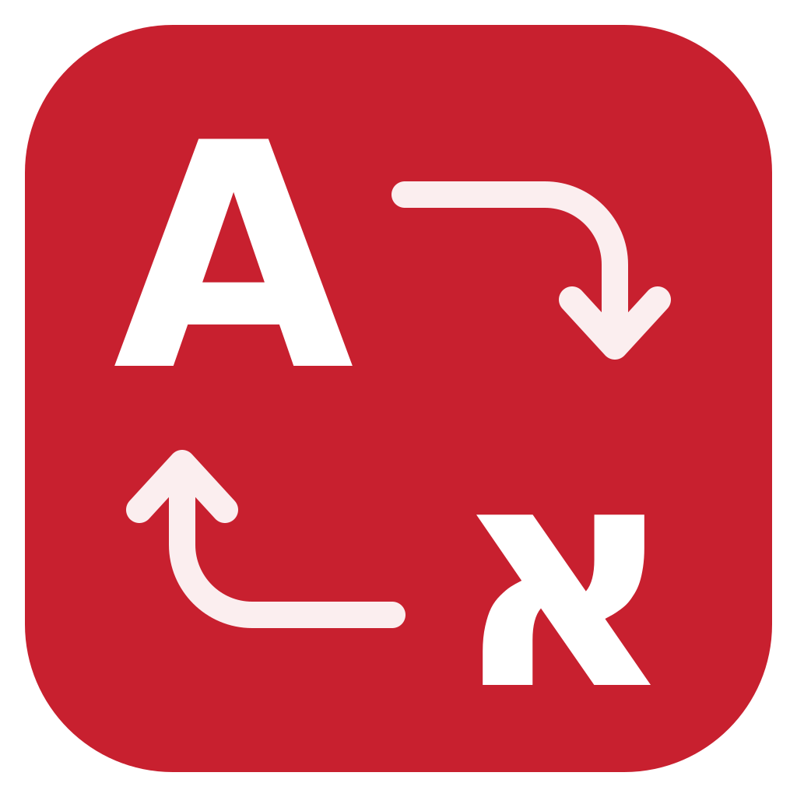
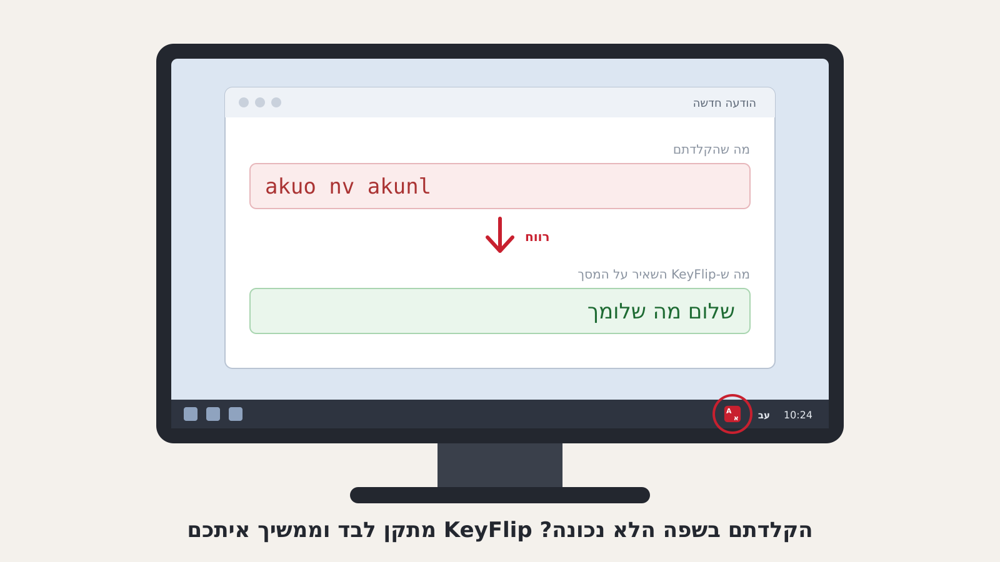

# KeyFlip – מתקן אוטומטי להקלדה בשפה הלא נכונה (עברית / אנגלית)

הקלדתם חצי משפט ורק אז גיליתם שהמקלדת הייתה על אנגלית? KeyFlip מזהה את זה תוך כדי הקלדה, מתקן את מה שנכתב ומעביר את המקלדת לשפה הנכונה, כדי שתמשיכו לכתוב בלי לעצור.

- מקלידים `akuo` ומקבלים **שלום**
- מקלידים `יקךךם` ומקבלים **hello**

KeyFlip עובד בכל תוכנה ב-Windows: Outlook, Teams, Word, Excel, דפדפנים ומערכות פנימיות. הוא חינמי, והקוד שלו פתוח.

## התקנה בדקה

1. ודאו שב-Windows מותקנות גם מקלדת **עברית** וגם מקלדת **אנגלית** (הגדרות ← זמן ושפה ← שפה ואזור).
2. הורידו את הקובץ [`KeyFlip.exe`](https://github.com/automationsstudent-pixel/KeyFlip/raw/main/dist/KeyFlip.exe).
3. הפעילו אותו. אין התקנה ואין צורך בהרשאות מנהל. הקובץ אינו חתום דיגיטלית, ולכן Windows עשוי להציג אזהרה: לוחצים על "מידע נוסף" ואז על "הפעל בכל זאת".
4. ליד השעון יופיע אייקון אדום עם האותיות A ו-א (לפעמים הוא מסתתר מאחורי החץ `^`).
5. כדי שיעלה לבד עם המחשב: לחיצה ימנית על האייקון ← **Start with Windows**.

התפריט של KeyFlip כתוב באנגלית.

## איך משתמשים

| מה אתם עושים | מה KeyFlip עושה |
|---|---|
| מקלידים מילה בשפה הלא נכונה ולוחצים רווח, Enter או סימן פיסוק | מחליף את המילה ומעביר את המקלדת לשפה הנכונה. האייקון מהבהב בירוק. |
| מתחילים משפט שלם בשפה הלא נכונה | מתקן גם את המילים הקודמות במשפט, ברגע שברור לאיזו שפה התכוונתם. |
| לוחצים **Pause** (או **Ctrl+Alt+Space**) מיד אחרי תיקון אוטומטי | **מבטל** את התיקון וזוכר את המילה, כך שהיא לא תתוקן שוב. |
| לוחצים **Pause** בכל רגע אחר | הופך את כל מה שהוקלד מאז הלחיצה האחרונה בעכבר. שימושי כשהתיקון האוטומטי פספס. |
| מסמנים טקסט ולוחצים **Shift+Pause** | הופך את הטקסט המסומן. |
| לחיצה כפולה על האייקון | מכבה או מדליק את KeyFlip. |

מילה שהיא מילה אמיתית בשפה שבה הוקלדה נשארת כמו שהיא, כך ש-KeyFlip לא נוגע בטקסט תקין.

## התאמה אישית (לחיצה ימנית על האייקון)

- **Turn off on this site / window** – מכבה את KeyFlip באתר או בחלון מסוים. האייקון הופך לאפור כשאתם שם.
- **My words** – רשימת מילים ש-KeyFlip לא ישנה לעולם: מונחים של החברה, קודים, שמות לקוחות. מילה בכל שורה.
- **Settings file** – שינוי קיצורי המקשים, רשימת תוכנות לדילוג, או כיבוי התיקון האוטומטי כך שרק קיצור המקשים יפעל.

## פרטיות ובטיחות

- הכול נשאר על המחשב שלכם. בקוד אין שום גישה לרשת.
- KeyFlip זוכר רק את המשפט הנוכחי, בזיכרון בלבד. הטקסט שאתם מקלידים לא נשמר לדיסק.
- שדות סיסמה, תוכנות שרצות כמנהל, חיבור מרחוק ומנהלי סיסמאות – KeyFlip לא פועל בהם.
- הקוד המלא פתוח לעיון ב-GitHub.

## מגבלות שכדאי להכיר

- לחיצה בעכבר או שימוש בחיצים גורמים ל-KeyFlip לשכוח את המשפט הנוכחי. זה מכוון, כי הוא לא יכול לדעת לאן הסמן עבר.
- היפוך טקסט מסומן משתמש לרגע בלוח ההעתקה, ואז מחזיר את מה שהיה בו.
- KeyFlip תומך בעברית ובאנגלית בלבד, ורק ב-Windows 10 ו-11.

## רישיון

הקוד מופץ תחת רישיון [MIT](LICENSE).

