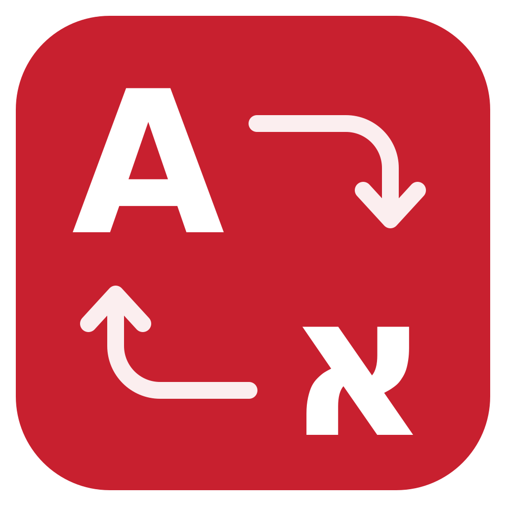
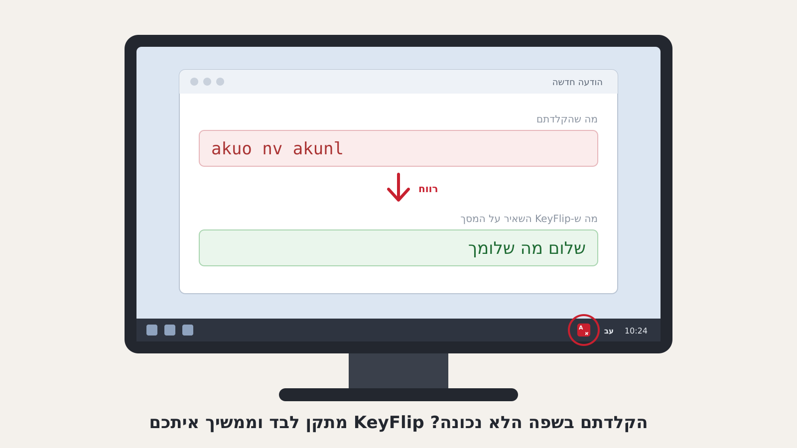

# KeyFlip — Hebrew/English wrong-keyboard fixer for Windows

**[מדריך בעברית ←](README.he.md)**

KeyFlip fixes text you typed with the keyboard set to the wrong language. Type `akuo` and you get `שלום`; type `יקךךם` and you get `hello`. It then switches the keyboard to the right language so you can keep typing. It works in every Windows program: Outlook (classic and new), Outlook on the web, Teams, Word, Excel, browsers and internal systems.

## Getting started

1. Make sure both **Hebrew** and **English** keyboards are installed (Settings → Time & language → Language & region).
2. Run `KeyFlip.exe`. Nothing needs installing, and it doesn't need administrator rights. A red **A/א** icon appears near the clock (it may be hidden under the `^` arrow).
3. Type as usual.

Right-click the tray icon and choose **Start with Windows** to have it start automatically.

## How it works

| What you do | What KeyFlip does |
|---|---|
| Type a word in the wrong keyboard and press space, Enter or punctuation | Replaces the word and switches the keyboard. The icon flashes green. |
| Start a whole sentence in the wrong keyboard | Fixes the earlier words of the sentence too, once it's clear which language you meant (for example `do tbh` → `גם אני`). |
| Press **Pause** (or **Ctrl+Alt+Space**) right after an automatic fix | **Undoes** it, and remembers that word so it is never changed again. |
| Press **Pause** at any other time | Flips everything typed since your last click, which helps when auto-fix missed something. |
| Select text, then press **Shift+Pause** | Flips the selected text. |
| Double-click the tray icon | Turns KeyFlip on or off. |

KeyFlip leaves a word alone when it's a real word in the language you typed it in, so it doesn't change correct text. It also skips very short ambiguous words (`do`/`גם`) until the next word shows what you meant.

## Personalizing

- **Turn off on this site / window** (tray menu): type something on the site first, then choose this option. KeyFlip suggests the site's name, taken from the tab title (for example `TraceView` from "Object 4471 - TraceView - Google Chrome"), and you can pick another part or type your own. From then on KeyFlip stays off in any window or tab whose title contains that text, and the tray icon turns gray while you're there. To turn it back on, go to **Sites where it's off** → **Turn back on for…**. The hotkey still works on those sites if you want to flip something by hand.
- **My words** (tray menu): add company terms, codes, client names and anything else KeyFlip should never change, one per line. Changes apply as soon as you save the file.
- **Settings file** (tray menu): change the hotkeys, list apps to skip, or turn off automatic fixing so it only works when you press the hotkey.
- **Keep a log of fixes**: writes each fix (only the changed words) to `fix-log.txt`. Turn this on for a week of testing and send back any wrong fixes so they can be tuned.

The files are kept in `%APPDATA%\KeyFlip\`.

## What changed in 0.3 (smoother fixes)

Earlier versions deleted the wrong word, then waited for the keyboard to switch, then typed the corrected word. The word was missing from the screen during that wait, which looked like text disappearing and coming back. Version 0.3 changes the order:

- KeyFlip now switches the keyboard first (nothing visible happens), then deletes and retypes in one step. The word changes in place.
- It reads the keyboard language from the control you are typing in, not from the window frame around it. In apps where those two differ, older versions kept seeing the old language and re-typed word after word.
- If an app won't confirm the keyboard switch, KeyFlip waits for it once (up to 0.4 s) and after that only briefly in that window.
- If an app changes the keyboard back by itself after a fix (some editors pick the keyboard to match nearby text), KeyFlip switches it again before your next letter, and in that app it goes back to the old order (delete, switch, type) for the rest of the session.
- Keys you press while a fix is being applied are passed on exactly as pressed, including Ctrl/Alt/Win shortcuts and arrow keys.
- If you move to another window in the instant a fix is being prepared, the fix is dropped instead of being typed into the other window.
- The fix log, "My words" file and tray icon are updated after your typing is flowing again, not in the middle of it.

## Known limits

- Clicking somewhere or using the arrow keys makes KeyFlip forget the current sentence. That's deliberate, because it can't tell where the cursor moved.
- Programs running as administrator are skipped, because Windows doesn't allow typing into them.
- Remote desktop, Citrix and password managers are skipped by default. Password fields are always skipped.
- Selection flipping briefly uses the clipboard, then restores what was in it.

---

## For IT / security review

- **What it is:** a single-file .NET Framework 4.8 tray application (built into Windows 10/11, nothing to install). It runs as the current user (`asInvoker`) and has no service and no driver.
- **How it works:** a standard `WH_KEYBOARD_LL` / `WH_MOUSE_LL` hook (the same mechanism text-expanders and layout switchers use). It keeps only the current sentence (up to 400 keystrokes) **in memory**, and clears it on every click, window change, Enter or navigation key. Typed text is never written to disk. The only optional log, off by default, records corrected words when the user turns it on.
- **Network:** none. The code has no network calls. The word lists (Hebrew and English frequency lists from the OpenSubtitles corpus, [FrequencyWords](https://github.com/hermitdave/FrequencyWords), CC BY-SA 4.0) are embedded in the exe.
- **Actions it performs:** `WM_INPUTLANGCHANGEREQUEST` to switch the focused window's keyboard layout, then a single `SendInput` call (backspaces + Unicode characters) to replace the text. It writes to `HKCU\…\Run` only when the user turns on "Start with Windows".
- **Safety:** it never acts in password fields (detected through the window style and UI Automation `IsPassword`), in elevated processes, or in excluded apps (RDP, Citrix, password managers by default).
- **Source:** the full C# source is included (`src/`, about 1,900 lines) with the detection tests (`tests/`) and an engine simulator (`sim/`). The simulator compiles the real `Engine.cs` against a stand-in for the Windows input system and measures, per scenario, how long text is missing from the screen during a fix; run it with `dotnet run -c Release --project sim`. Build the app with `dotnet build -c Release src/KeyFlip.csproj` (.NET SDK 8+). The exe isn't code-signed. IT can sign it with the company certificate or build it from source themselves.
